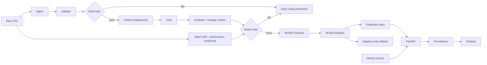

# Project 4 — House Price MLOps Pipeline

End-to-end MLOps capstone for predicting property asking prices in **₹ lakhs** from the supplied house-price data. The repository implements an automated, fail-closed lifecycle from raw data through validation, feature engineering, training, evaluation, quality gates, MLflow tracking/registry, FastAPI serving, operational monitoring, and incoming-batch drift/performance monitoring.

> **Evidence rule:** this README describes the implementation and recorded evidence only. It does not claim live MLflow, Docker, Grafana, GitHub Actions, GitHub Release, or team-contribution evidence unless such evidence is actually present. Environment-dependent acceptance steps are clearly marked.

## 1. Architecture



See [`docs/ARCHITECTURE.md`](docs/ARCHITECTURE.md), [`docs/DESIGN_NOTE.md`](docs/DESIGN_NOTE.md), and [`docs/WORKFLOW_GRAPH.md`](docs/WORKFLOW_GRAPH.md).

## 2. Source of truth and configuration

`config/config.yaml` is the configuration source of truth. The typed configuration layer validates paths, feature roles, data-contract rules, preprocessing, model hyperparameters, quality-gate thresholds, MLflow settings, drift calibration settings, and operational settings.

Validate configuration before running the pipeline:

```bash
PYTHONPATH=src python -m mlops_pipeline validate-config
```

The repository deliberately avoids hard-coded production paths, model hyperparameters, gate thresholds, and Phase 14 bootstrap parameters in executable code. Comments in the YAML explain evidence/rationale where a value is derived from the supplied data.

See [`docs/CONFIGURATION.md`](docs/CONFIGURATION.md).

## 3. Setup

### Requirements

- Python 3.10+; the tested container/runtime path uses Python 3.12.
- Python packages from `requirements.txt` and `requirements-dev.txt`.
- Docker is required only for container/Prometheus/Grafana acceptance.
- A reachable MLflow tracking/registry service is required for live tracking, registration, promotion, lineage, and registry-backed serving.
- GitHub access is required for live CI/CD/release evidence.

Create an environment:

```bash
python -m venv .venv
source .venv/bin/activate
python -m pip install --upgrade pip
python -m pip install -r requirements-dev.txt
```

The package can also be installed editable without resolving a second dependency set:

```bash
pip install -e . --no-deps
```

### Initial checks

```bash
PYTHONPATH=src python -m mlops_pipeline validate-config
PYTHONPATH=src python -m mlops_pipeline check-contract
```

## 4. Data and ingestion

Configured raw inputs are:

- `data/raw/capstone_house_prices_train.csv` — historical training data.
- `data/raw/capstone_incoming_batches.csv` — supplied incoming data containing Batch 1, Batch 2, and Batch 3 with actual `Price_Lakhs` for monitoring.

The supplied datasets are treated as inputs. Phase 14 monitoring did not modify them; the SHA-256 of the incoming file was unchanged before and after monitoring.

The ingestion stage reads the configured CSV into a DataFrame. Validation then applies the configured data contract and validation rules.

## 5. Pipeline execution

### Complete orchestrated pipeline

```bash
PYTHONPATH=src python -m mlops_pipeline orchestrate
```

The Prefect flow contains named stages for ingestion, validation/Data Gate, feature engineering, training/evaluation, Model Gate, and registry promotion. If Prefect is unavailable locally, the repository has a stage-compatible fallback for local testing; live Prefect orchestration/run history requires Prefect to be installed and executed in the target environment.

### Train/evaluate without registry promotion

```bash
PYTHONPATH=src python -m mlops_pipeline train
```

### Independent stage demonstrations

```bash
PYTHONPATH=src python scripts/run_stage.py ingest
PYTHONPATH=src python scripts/run_stage.py validate
PYTHONPATH=src python scripts/run_stage.py data-gate
PYTHONPATH=src python scripts/run_stage.py feature-engineering
PYTHONPATH=src python scripts/run_stage.py train
PYTHONPATH=src python scripts/run_stage.py evaluate
PYTHONPATH=src python scripts/run_stage.py model-gate
PYTHONPATH=src python scripts/run_stage.py monitor
```

See [`docs/STAGE_RERUN_RUNBOOK.md`](docs/STAGE_RERUN_RUNBOOK.md). Registry promotion is intentionally protected as a pipeline operation and is not exposed as an unrestricted stage command.

## 6. Data Gate

The Data Gate is fail-closed. It validates the incoming training/monitoring dataset before downstream training work can proceed.

Checks include:

- schema and unexpected/duplicated columns;
- configured dtypes and nullability;
- numeric plausibility ranges;
- missing-value fractions;
- categorical allowed values;
- target presence, finiteness, range, and non-constant target;
- duplicate-record checks;
- identifier format, uniqueness, and training/incoming separation where applicable.

A Data Gate failure raises an explanatory validation error and stops downstream pipeline work. The production model remains unchanged.

See [`docs/DATA_VALIDATION.md`](docs/DATA_VALIDATION.md).

## 7. Feature engineering

Preprocessing is configuration-driven. Numeric features use median imputation without missingness indicators. Categorical features use the configured ordinal encoding for `Property_Condition` and one-hot encoding for `City_Zone`. No target-derived feature is created.

The same preprocessing contract is used for model training and serving.

## 8. Training and evaluation

Two configured models are compared using the same train/validation split, preprocessing, and metrics:

- `linear_regression_baseline`
- `gradient_boosting_candidate`

The primary metric is **MAE in ₹ lakhs**; lower is better. RMSE and R² are also reported. Five-fold CV is used as an additional stability check.

The current checked-in configuration selects the simpler baseline because the supplied evidence did not establish a meaningful candidate advantage and the baseline was better on several supporting metrics.

No hyperparameter tuning occurs at runtime; configured hyperparameters are fixed in YAML.

## 9. Model Gate

The Model Gate protects production in two ways:

1. **Absolute threshold:** the candidate must satisfy the configured maximum primary metric.
2. **Production comparison:** the candidate must also improve on the current production model according to the configured comparison rule.

Therefore, a candidate that is absolutely acceptable but worse than production is rejected.

When the gate fails, registry promotion is not called and the previous production model remains in service.

## 10. MLflow tracking, Registry, promotion, and lineage

The pipeline records experiment/model evidence in MLflow and uses the MLflow Model Registry as the production model authority.

The production alias identifies the approved serving version. Promotion is pipeline-controlled and occurs only after the Model Gate passes.

FastAPI resolves the production model through the registry; it does not fall back to `artifacts/models/selected_model.joblib` as a production source.

### Lineage

The intended live lineage chain is:

```text
production alias
  -> registered model version
  -> MLflow run
  -> source/code/config/data evidence
  -> model artifact
```

Use:

```bash
PYTHONPATH=src python -m mlops_pipeline verify-lineage
```

The checked-in archive records the local verifier result, but live MLflow lineage requires a reachable MLflow service and registered production version. Do not treat the local archive as proof of a live registry lineage run.

## 11. Production safety and rollback

Only the pipeline changes the production model. Failed Data Gate and Model Gate paths preserve production.

Rollback is registry-only:

```bash
PYTHONPATH=src python -m mlops_pipeline rollback-production <target_version> \
  --expected-current-version <current_version> \
  --reason "restore previous known-good production version"
```

The rollback operation changes the MLflow production alias to an already-approved registered version. It does not manually copy model files.

See [`docs/RELEASE_AND_ROLLBACK.md`](docs/RELEASE_AND_ROLLBACK.md).

## 12. FastAPI serving

The serving application is in `src/mlops_pipeline/serving/`.

Key endpoints:

- `GET /health` — service/model readiness and version metadata.
- `POST /predict` — prediction using the registry-resolved production model.
- `GET /metrics` — Prometheus exposition format.
- `GET /metrics/json` — human-readable diagnostics.

Local development example:

```bash
MLOPS_CONFIG=config/config.yaml PYTHONPATH=src uvicorn mlops_pipeline.serving.api:app --host 0.0.0.0 --port 8000
```

The API requires a reachable approved production registry model for real production serving. It fails safely if that model cannot be resolved.

## 13. Docker deployment

The Docker image is a serving image only. It does not copy the training data, MLflow store, or candidate/selected model artifacts into the image. The container loads the approved model through MLflow.

Build from a real Git checkout so the image is commit-traceable:

```bash
export GIT_COMMIT="$(git rev-parse HEAD)"
./scripts/build-image.sh
```

The image exposes port `8000` and includes a healthcheck against `/health`.

For local runtime acceptance:

```bash
docker run --rm -p 8000:8000 \
  -e MLOPS_CONFIG=/app/config/config.yaml \
  <image-tag>
```

A live MLflow URI/credentials must also be supplied according to the deployment environment.

## 14. CI/CD

### Pull requests

`.github/workflows/pr-checks.yml` runs:

1. configuration validation;
2. unit tests;
3. integration tests;
4. lightweight ingestion → validation → Data Gate smoke test.

A failing step fails the workflow; errors are not suppressed.

### Main/release

`.github/workflows/release.yml` re-runs configuration/unit/integration/smoke checks and then builds/publishes a commit-traceable serving image to GHCR and creates a GitHub Release.

The release workflow does **not** train, register, or promote a model. Model promotion remains governed by the ML pipeline and gates.

Live GitHub PR/release history is external evidence and must be captured from the actual repository for submission.

## 15. Operational monitoring

Operational monitoring is intentionally separate from ML/data drift monitoring.

Prometheus scrapes `GET /metrics` every 5 seconds in the supplied Docker Compose configuration. Grafana is provisioned with a Prometheus datasource and a dashboard at `monitoring/grafana/dashboards/house-price-operational.json`.

The dashboard covers:

| Metric | Meaning | Source |
|---|---|---|
| Request count/rate | Number/rate of HTTP requests, especially `/predict` | `mlops_http_requests_total` |
| Latency | Request duration, including p95 dashboard query | `mlops_http_request_duration_seconds` |
| Error rate | 4xx/5xx request rate and prediction errors | HTTP counter + `mlops_prediction_errors_total` |
| Prediction distribution | Distribution of predicted `Price_Lakhs` values | `mlops_prediction_value` histogram |

Run the stack:

```bash
export GIT_COMMIT="$(git rev-parse HEAD)"
docker compose -f monitoring/docker-compose.yml up --build
```

Then use Prometheus on port `9090` and Grafana on port `3000` as described in `monitoring/README.md`.

The repository contains local evidence that real API traffic changed the Prometheus metrics. A live Grafana panel observation must be captured in a Docker-capable environment; no dashboard screenshot is fabricated in this archive.

## 16. Drift and performance monitoring

Run the supplied batches:

```bash
PYTHONPATH=src python -m mlops_pipeline monitor-batches
```

The monitor uses the **training data as the reference** and evaluates all supplied batches without changing them.

### Feature/data drift

Feature drift is measured with PSI and an empirical bootstrap calibration. The batch-level trigger is based on the observed number of features exceeding their calibrated PSI threshold rather than visual inspection.

### Model performance drift

Because actual `Price_Lakhs` is supplied for Batch 1/2/3, performance drift is measured using the production model's predictions and actual targets. The primary metric is MAE, compared with the reference performance using an evidence-based relative-degradation threshold.

Recorded supplied-batch result:

| Batch | Feature drift | Performance concern | MAE | Relative MAE degradation |
|---|---|---|---:|---:|
| 1 | No | No | 5.5694 | -3.86% |
| 2 | Yes | Yes | 6.8813 | +18.78% |
| 3 | Yes | Yes | 13.1237 | +126.54% |

Batch 3 shows the strongest degradation. Drift is an investigation/retraining signal; it **does not automatically replace production**. Any retrained candidate must pass the Data Gate and Model Gate before promotion.

Evidence is under `reports/phase14_evidence/`.

## 17. Reproducibility

The reproducibility controls include:

- configuration source of truth in YAML;
- explicit random seed in configuration;
- fixed model hyperparameters in YAML;
- deterministic preprocessing/splitting;
- recorded environment/version metadata in MLflow code paths;
- reproducibility checker:

```bash
PYTHONPATH=src python -m mlops_pipeline reproducibility-check
```

The local evidence confirms repeated training produced matching metrics for the tested inputs. A clean-clone reproduction in the final submission environment should also be captured because the current archive cannot prove an independent clean-clone environment.

## 18. Testing

Run all tests:

```bash
PYTHONPATH=src python -m pytest
```

Run separately:

```bash
PYTHONPATH=src python -m pytest tests/unit
PYTHONPATH=src python -m pytest tests/integration
```

Useful focused tests include:

```bash
PYTHONPATH=src python -m pytest tests/unit/test_model_quality_gate.py
PYTHONPATH=src python -m pytest tests/unit/test_model_registry.py
PYTHONPATH=src python -m pytest tests/unit/test_phase12_rollback.py
PYTHONPATH=src python -m pytest tests/unit/test_phase13_monitoring.py
PYTHONPATH=src python -m pytest tests/unit/test_phase14_drift.py
```

The repository's final local evidence records the relevant unit/integration runs under `reports/` and the Phase 15 audit under `reports/phase15_evidence/`.

## 19. Failure scenarios for the demo

### Bad data

Use the existing derived-fixture integration test. It introduces an invalid categorical value, verifies Data Gate failure, verifies training is not invoked, and verifies production remains unchanged.

### Bad model

Use the existing Model Gate test fixture. It exercises a candidate below the configured absolute threshold and verifies no production change.

### Worse-than-production model

Use the production-comparison gate test. It verifies that an absolute-threshold pass is still rejected when the candidate is worse than production.

## 20. Evidence and documentation map

- `PHASE_1_HANDOFF.md` … `PHASE_15_HANDOFF.md` — phase evidence.
- `FINAL_INTEGRATION_REPORT.md` — complete integration audit.
- `FINAL_AUDIT.md` — final compliance/evidence status.
- `FINAL_AUDIT_REMEDIATION_LOG.md` — fixes made from the final audit.
- `docs/ARCHITECTURE.md` — architecture and component contracts.
- `docs/DESIGN_NOTE.md` — concise design note.
- `docs/WORKFLOW_GRAPH.md` — Prefect workflow graph and stage lifecycle.
- `docs/STAGE_RERUN_RUNBOOK.md` — independent stage execution.
- `docs/DATA_VALIDATION.md` — validation and Data Gate methodology.
- `docs/RELEASE_AND_ROLLBACK.md` — CI/CD release and registry rollback.
- `docs/AI_USE_DISCLOSURE.md` — project AI-use disclosure.
- `docs/REFLECTION.md` — final reflection.
- `FINAL_DEMO_SCRIPT.md` — 5–10 minute demonstration script.
- `FINAL_SUBMISSION_CHECKLIST.md` — final submission evidence checklist.

## 21. Final evidence boundary

The repository contains executable local evidence for the ML pipeline, gates, API, Prometheus metric generation, drift monitoring, reproducibility checks, and CI policy checks. The following require execution in their real target environments and are therefore not represented as completed unless evidence is added:

- live MLflow tracking/registry/lineage;
- live Prefect run history/UI;
- Docker build/start acceptance;
- live Grafana panel update;
- GitHub failing and passing PR history;
- GitHub Release/GHCR image evidence;
- two-member Git contribution history.

This distinction is intentional and is part of the submission's evidence integrity.
