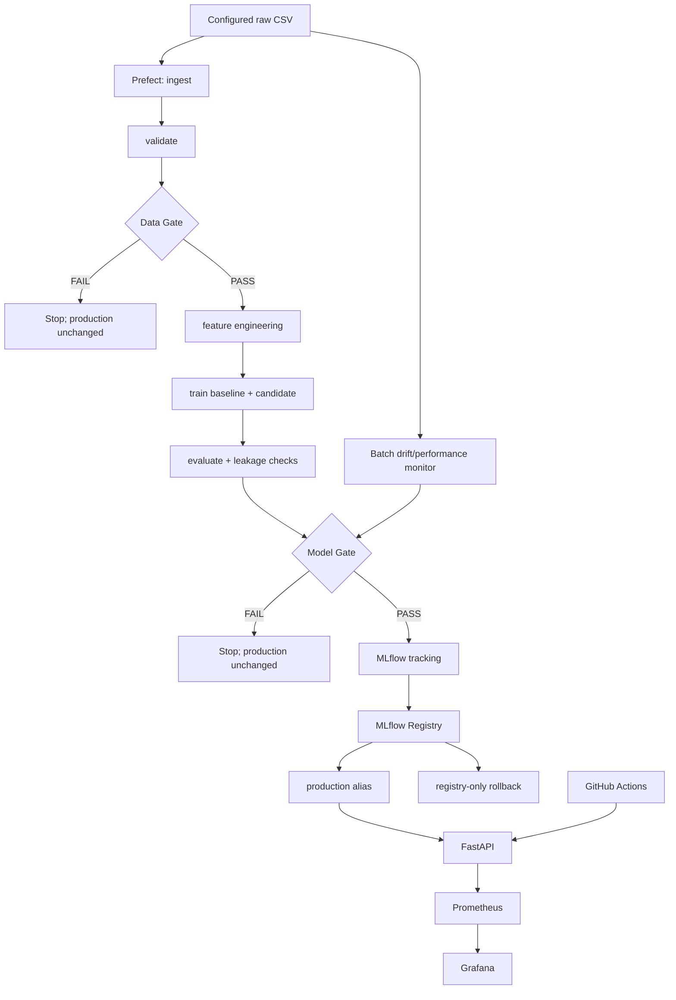

# Project 4 Architecture

## Purpose

This document describes the implemented system, not a proposed future design.

## End-to-end flow

## Configuration

`config/config.yaml` is the source of truth. The config loader validates configuration structure, paths, model settings, data contract, validation, gates, MLflow, drift calibration, and operational settings.

## Stage contracts

| Stage | Input | Output / side effect | Safety boundary |
|---|---|---|---|
| Ingest | configured CSV | DataFrame | no model mutation |
| Validate | DataFrame | validation report | failure stops pipeline |
| Data Gate | DataFrame + report | gated DataFrame | failure prevents training |
| Feature Engineering | gated data | processed split | uses training-derived preprocessing |
| Train | processed split | baseline/candidate models | no production mutation |
| Evaluate | trained models | metrics + comparisons | no production mutation |
| Model Gate | candidate + production comparison | pass/fail | failure prevents registry promotion |
| MLflow tracking | approved run | run/model evidence | requires reachable MLflow for live operation |
| Registry | approved candidate | registered version | only approved pipeline path changes production alias |
| Serving | production alias | predictions | no local arbitrary-model fallback |
| Operational monitor | serving traffic | Prometheus metrics | separate from drift monitoring |
| Drift monitor | training reference + incoming batches + production model | evidence report | never auto-replaces production |

## Production model authority

The MLflow Registry production alias is authoritative. The serving loader resolves that alias at startup and rejects unapproved/non-production registry versions. Local model artifacts under `artifacts/models/` are training/evidence artifacts, not an alternative production source.

## CI/CD boundary

The PR workflow validates configuration/tests and a lightweight Data Gate smoke. The main-release workflow revalidates the commit and publishes a serving image. It does not train or promote a model. Model promotion remains a gated pipeline operation.

## Monitoring boundary

Operational monitoring measures service behavior:

- requests/throughput;
- latency;
- errors;
- predicted-price distribution.

ML/data monitoring measures model/data behavior on supplied incoming batches:

- feature drift;
- performance drift using actual `Price_Lakhs`.

The two monitoring systems are intentionally separate.

## Evidence boundary

Local tests prove the implementation contracts that can run in the supplied environment. Live MLflow, Prefect UI, Docker, Grafana, GitHub PR/release, and two-member Git evidence require the target environment and are not inferred from source code alone.
