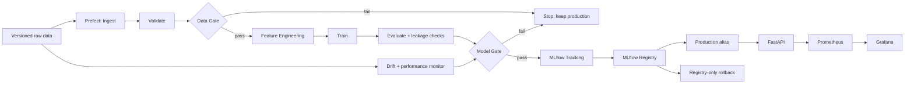

# Project 4 Design Note

## Objective and non-functional requirements

Predict property asking price (`Price_Lakhs`) from the supplied listings. The primary success metric is MAE in ₹ lakhs: lower is better and the number can be read directly as average absolute pricing error. The service exposes a FastAPI endpoint and operational Prometheus/Grafana monitoring. Model freshness is governed by evidence-based drift/performance alerts and retraining remains subject to the Model Gate.

## Architecture

## Lifecycle traceability

| Lifecycle stage | Component |
|---|---|
| Data | YAML paths, ingestion, validation, Data Gate |
| Experiment | training/evaluation, MLflow tracking |
| Model management | Model Gate, MLflow Registry, promotion/rollback |
| Deployment | FastAPI, Docker, CI/CD release workflow |
| Monitoring | Prometheus/Grafana operational metrics; separate drift/performance monitor |

The YAML file is the configuration source of truth. Production transitions are pipeline-controlled. Drift is an alerting signal and cannot bypass the Model Gate.
