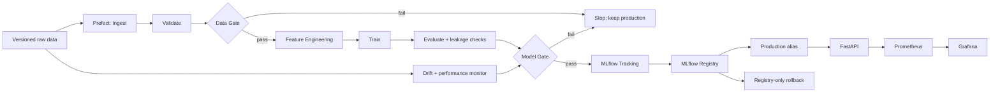

# Project 4 Design Note

## 1. Objective and Non-Functional Requirements

**Business objective:** Predict property asking prices (`Price_Lakhs`) from the supplied property listings using a reproducible machine-learning pipeline.

**Primary success metric:** Mean Absolute Error (MAE), measured in ₹ lakhs on the held-out validation set. Lower is better. The observed linear-regression baseline validation MAE is **5.7931 lakhs**. This is the measured reference result, not a separately established business acceptance target.

**Evaluation and model selection:** The linear-regression baseline achieved validation MAE of 5.7931 lakhs, RMSE of 7.5044 lakhs and R² of 0.8831. The gradient-boosting candidate achieved validation MAE of 5.7777 lakhs, RMSE of 7.5846 lakhs and R² of 0.8806. Although the candidate improved validation MAE by approximately 0.27%, its five-fold cross-validation MAE was worse (5.8569 versus 5.6820 lakhs), and it performed better than the baseline in only one of five folds. The simpler baseline is therefore retained in the configuration.

**Prediction latency and reliability:** The configured operational limits are p95 prediction latency of **100 ms** and an error rate of **1%**. These are monitoring targets that must be verified using operational measurements.

**Model freshness:** Incoming data batches are monitored for feature drift and performance degradation. Alerts trigger investigation and possible retraining; they do not automatically authorize model promotion. Any replacement model must pass the Model Gate.

**Data and model safety:** Invalid data must fail the Data Gate. A candidate that fails evaluation or the Model Gate must not replace the current production model. Failed validation or evaluation must preserve the existing production model and serving endpoint.

## 2. Success Thresholds and Justification

| Area | Configured threshold or criterion | Justification |
|---|---|---|
| Baseline reference | Validation MAE = 5.793117272533898 lakhs | Measured baseline result on the held-out validation set. |
| Model quality | Candidate validation MAE ≤ 5.793117272533898 lakhs | Uses the observed baseline MAE as the configured maximum candidate MAE. |
| Production comparison | Candidate must strictly improve on the production model; `min_improvement = 0.0` | Prevents promotion without an improvement in the primary metric. Equality does not count as improvement. |
| Feature drift | Per-feature PSI threshold = 0.038274 | Configured threshold calibrated from the training-reference null distribution. |
| Drifted-feature share | Threshold = 0.2222222222, equivalent to 2 of 9 features | Configured empirical 95th-null share threshold. |
| Performance degradation | Relative MAE degradation threshold = 0.0602811985 | Configured empirical 95th-null degradation threshold. |
| Prediction latency | p95 ≤ 100 ms | Configured operational response-time limit. |
| API error rate | ≤ 1% | Configured operational reliability limit. |
| Data quality | Inputs must pass the configured validation rules in `config/config.yaml` and `docs/DATA_VALIDATION.md` | Prevents invalid data from proceeding through the pipeline. |

The model-quality threshold is a reference derived from observed baseline performance, not proof of business-acceptable pricing accuracy. Drift and performance thresholds are monitoring thresholds, not direct model-promotion criteria. Their interpretation follows the configuration and monitoring implementation.

## 3. Architecture

## 4. Lifecycle Traceability

| Lifecycle stage | Component and responsibility |
|---|---|
| Data | YAML-configured paths, ingestion, validation and Data Gate. |
| Experiment | Training, evaluation, leakage checks and MLflow experiment tracking. |
| Model management | Model Gate, MLflow Registry, production promotion and rollback. |
| Deployment | FastAPI inference service, Docker and CI/CD release workflow. |
| Monitoring | Prometheus/Grafana operational metrics and separate drift/performance monitoring. |

## 5. Reproducibility and Production Safety

The YAML configuration is the source of truth for paths, model settings and thresholds. Pipeline stages are designed to be independently runnable and orchestrated through Prefect. Evaluation records model metrics and leakage-check results. Production transitions are controlled by the Model Gate and model registry rather than by drift alerts alone.

The Data Gate prevents invalid input data from proceeding. The Model Gate checks candidate quality and comparison with the production model. If a gate fails, the existing production model should remain in service. Rollback uses the registered production model version, subject to the implemented deployment procedure.

Monitoring evidence should include operational latency and error rate, feature-drift measurements, performance degradation and incoming batch identifiers. Thresholds must remain consistent with `config/config.yaml` and the monitoring implementation.
