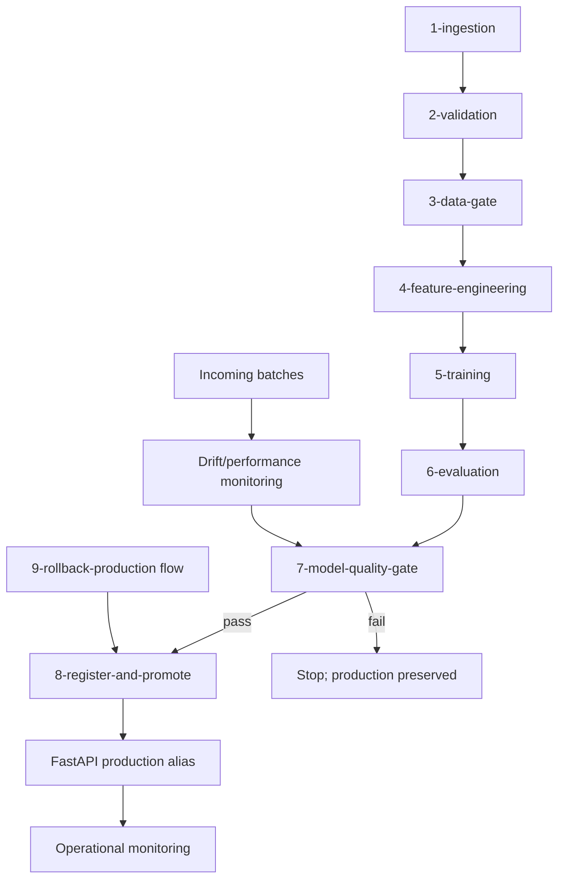

# Prefect Workflow Graph

The graph below matches the named tasks in `src/mlops_pipeline/pipeline/prefect_flow.py`.

### Run history

Live Prefect run-history evidence is environment-dependent and is not fabricated in this repository. Run the flow with Prefect installed and capture the resulting run history in the final submission.
